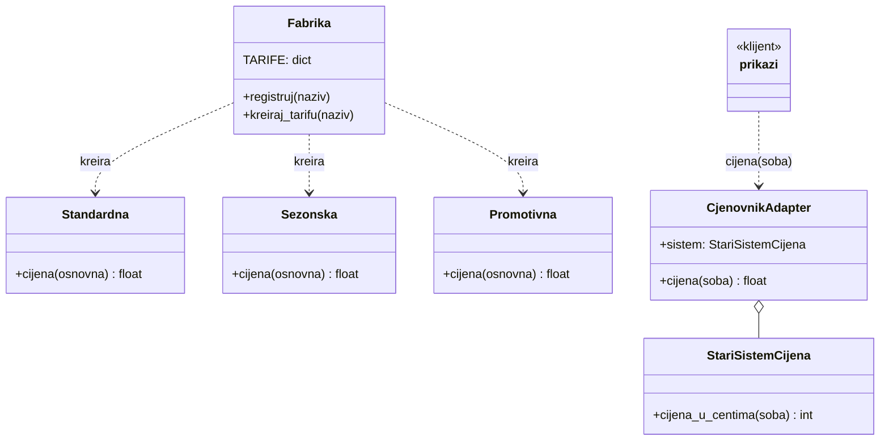

# Nedelja 3

## Projektni šabloni I - stvaralački i strukturni

Teme:

- Pojam, klasifikacija i kriterijum primjene šablona
- Stvaralački: Factory, Builder i Singleton
- Strukturni: Adapter, Decorator i Facade

Kada koristiti šablon:

- Kada se isti problem ponavlja na različitim mjestima
- Samo ako je potreban - nepotreban šablon komplikuje kod

## Klasifikacija

| Grupa | Šta rješava | Šabloni |
|---|---|---|
| Stvaralački | kako se objekti kreiraju | Factory, Builder, Singleton |
| Strukturni | kako se objekti povezuju | Adapter, Decorator, Facade |
| Šabloni ponašanja | kako objekti sarađuju | Nedelja 4 |

## Stvaralački šabloni

### Factory

- Kreiranje objekta prema nazivu
- **Problem:** izbor klase prema konfiguraciji zahtijeva lanac `if/elif`
- **Rješenje:** registar i funkcija koja kreira objekat
- **Posljedica:** nova klasa se dodaje bez izmjene fabrike

### Builder

- Postepena izgradnja složenog objekta
- **Problem:** konstruktor sa velikim brojem opcionih parametara
- **Rješenje:** metode koje vraćaju `self`, validacija u `build()`
- **Posljedica:** čitljiv poziv i kontrolisano stanje objekta

### Singleton

- Jedna instanca u Pythonu
- **Cilj:** tačno jedna instanca na nivou programa
- **U Pythonu:** modul ili `@lru_cache(maxsize=1)` su dovoljni
- **Primjena:** konfiguracija, klijent baze, logger
- **Rizik:** globalno stanje otežava testiranje

## Strukturni šabloni

### Adapter

- Prilagođavanje interfejsa
- **Problem:** postojeći sistem pruža drugačiji interfejs od očekivanog
- **Rješenje:** omotač koji prevodi jedan interfejs u drugi
- **Posljedica:** klijentski kod ostaje nepromijenjen

### Decorator

- Dodavanje ponašanja
- **Šablon:** objekat istog interfejsa omotava drugi i dodaje ponašanje
- **Python `@dekorator`:** isti princip primijenjen na funkciju
- **Lanac dekoratora:** osnovna tarifa → sa popustom → sa taksom → krajnja cijena

### Facade

- Jedinstvena ulazna tačka
- **Problem:** klijent mora poznavati više podsistema i njihov kod
- **Rješenje:** jedna klasa koja objedinjuje tok rada
- **Posljedica:** podsistemi se mogu mijenjati bez izmjene klijenta

## Zadatak

- **Scenarij A:** aplikacija učitava tarifu prema nazivu iz konfiguracione datoteke
  ("standardna", "sezonska", "Promotivna") → **Factory**
- **Scenarij B:** sistem rezervacija koristi stari sistem cijena koji vraća cijenu u centima,
  a ostatak koda očekuje eure → **Adapter**

Rješenje i testovi su u [`nedelja3.py`](nedelja3.py).

