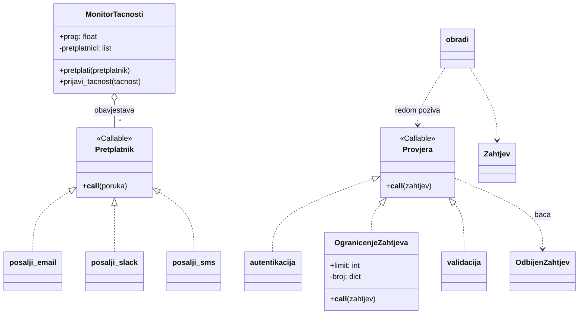

# Nedelja 4

## Projektni šabloni II - šabloni ponašanja

| Šablon | Ideja |
|---|---|
| Strategy | Zamjenjivi algoritam iza istog interfejsa |
| Observer | Objekti se pretplate na događaje i dobijaju obavještenja |
| Template Method | Okvir algoritma je fiksan, koraci se prilagođavaju |
| Chain of Responsibility (Pipeline) | Zahtjev prolazi kroz lanac obrađivača |
| Command | Radnja predstavljena objektom |
| State | Ponašanje zavisi od stanja objekta |
| Iterator | Obilazak kolekcije bez otkrivanja strukture |

### Strategy

- Zamjenjivi algoritam
- **Problem:** lanac `if/elif` za
- **Rješenje:** svaka varijanta je funkcija ili

### Observer

- Pretplata na događaje
- **Problem:** trening treba da obavijesti više strana
- **Rješenje:** lista pretplatnika koji primaju događaj

### Template Method

- Fiksiran okvir algoritma

### Chain of Responsibility (Pipeline)

- Lanac provjera
- **Ideja:** zahtjev prolazi kroz lanac, svaki član provjerava ili prekida obradu
- **Posljedica:** provjere se dodaju ili uklanjaju nezavisno
- **U praksi:** middleware, guardrails

### Command

-

### State

-

### Iterator

-

## Petlja AI agenta i šabloni u njoj

- Cilj → Planiranje → Akcija → Posmatranje → Odgovor
- **Primjer:** n8n, alat za pravljenje AI tokova rada (workflows)

## Zadatak

| Scenarij | Opis | Šablon |
|---|---|---|
| A | Obavještenje na e-poštu, Slack i SMS kada tačnost modela padne ispod praga | Observer |
| B | Zahtjev prolazi autentikaciju, ograničenje broja zahtjeva i validaciju prije modela | Chain of Responsibility |
| C | Četiri načina obračuna cijene (standardna, studentska, akcijska, VIP) birana u toku rada | Strategy |
| D | Isti koraci za svaki model (učitavanje, priprema, treniranje, evaluacija), razlikuje se samo treniranje | Template Method |

Implementirani su scenariji A i B, rješenje i testovi su u [`nedelja4.py`](nedelja4.py).

